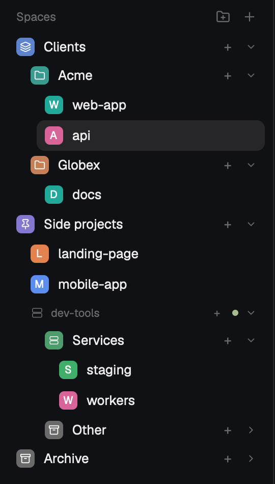
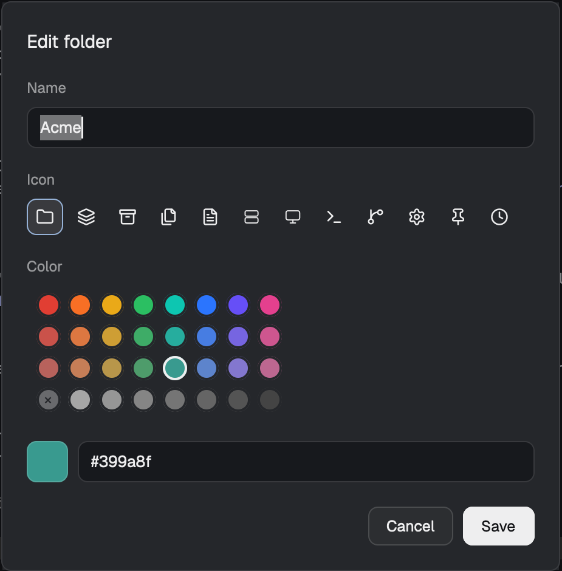

# Folders

Folders is a sidebar mod for Herdr. It is Herdr's own Spaces sidebar with nested folders added. You can put spaces, remote machines and other folders inside a folder, to any depth. Everything else in the sidebar works as Herdr ships it.

## Features

- Nested folders to any depth.
- Free order. Folders, spaces and machines can be siblings, at the root and in any folder.
- A remote machine is a folder. You can put it in folders and fill it with folders. Items never cross machines.
- 12 shipped icons for a folder.
- 32 preset colors in 4 rows of 8: vibrant, a little muted, more muted, and greys. You can also pick "No color" or enter a custom hex value.
- Drag and drop to move spaces, folders and machines.
- All else is Herdr's standard sidebar, unchanged: space rows, git tail, worktrees and the space menu.

## Install

Option 1. Copy the mod.

1. Copy `mods/herdr-folders` into `~/.config/herdr-app/mods/`.
2. Open your layout file. In the sidebar block, change `"mod"` from `"spaces"` to `"herdr-folders"`. To keep your layout as it is, clone it first and edit the clone:
   `herdr-app do layout.clone '{"name":"main","as":"main-folders"}'`
3. Check the mod:
   `herdr-app check ~/.config/herdr-app/mods/herdr-folders`

Option 2. Give your Herdr agent the URL of this repo. It installs the mod from the files, or builds it from `RECIPE.md`.

## Use

| Action | Where | Result |
|---|---|---|
| New folder at root | Folder-plus button on the "Spaces" header | A folder named "New folder" appears at the root. The Edit folder dialog opens. |
| New folder inside | Right-click a folder or machine, then "New folder here" | Same, inside that folder or machine. |
| Edit folder | Right-click a folder, then "Edit folder…" | A dialog for the name, the icon, and the color (32 presets, plus a hex field with a preview). |
| Set color | Right-click a folder | 32 swatches at the top of the menu. Row 4 starts with "No color". |
| Delete folder | Right-click a folder, then "Delete folder" | The contents move to the parent folder, at the place of the deleted folder. No space closes. |
| Fold or unfold | Click a folder or machine row | The state is stored in the tree. |
| New space in a folder | "+" on a folder row | The folder unfolds. A new space opens, and it goes in that folder. |
| Move | Drag a space, folder or machine onto a folder, or between rows | A drop line shows only where the drop is allowed. Drag is the only way to move. |

The space right-click menu is Herdr's own.

## Machines

- This computer is the root. The sidebar shows no "This computer" header.
- A remote machine shows Herdr's machine header. You cannot rename or delete it.
- A machine can sit at the root or in a folder that is outside any machine.
- A machine can hold folders to any depth.
- A remote space stays inside its machine. A local space never goes inside a machine.
- You cannot move an item into itself or into one of its own descendants.
- A space or machine that no longer exists is not drawn. Its place stays in the store, so a machine that comes back returns to its place.

## Where folders are stored

The tree is in Herdr shared state, under the key `herdr-folders`. Herdr saves shared state to disk. There is one tree for each computer. Other computers do not see it.

## Updating from Herdr

This section is for maintainers. The `herdr-spaces` branch holds Herdr's untouched spaces mod.

1. Run `scripts/pull-herdr.sh <tag>` (for example `v0.1.14`). It imports that release into `herdr-spaces`.
2. Run `git merge herdr-spaces` on your working branch.
3. Set `cloned_from.version` in `mods/herdr-folders/mod.json`, and the version in the header of `main.js`.

## Development

- `npm test` runs `node --test`. There are no dependencies.
- `herdr-app check mods/herdr-folders` checks the mod.

## License

herdr-folders is MIT licensed (`LICENSE`). `mods/herdr-folders/main.js` started as Herdr's spaces mod v0.1.13, which is Apache 2.0 (`LICENSE-APACHE`, `NOTICE`).
