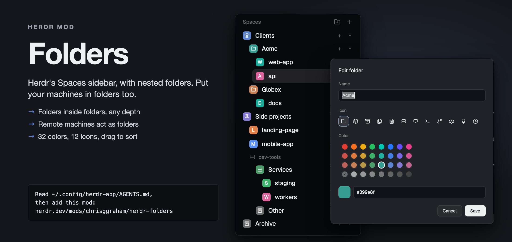

# Folders

Folders is a Herdr sidebar mod. It shows Herdr's Spaces sidebar with nested folders. A folder holds spaces, remote machines and other folders, to any depth. Each folder has an icon and a color.

## What you see

- The standard Herdr Spaces sidebar, with the header "Spaces". The header has a folder-plus button (26px square, 14px icon, `mods/workspace-chrome/folder-plus.svg`).
- No "This computer" header. The root is this computer.
- A folder row is 28px high. It has an 18px tile (radius 5px) with a white 11px icon, the folder name in medium weight, a "+" button, and a chevron (11px, `chevron-right.svg` when folded, `chevron-down.svg` when open).
- The tile color is the folder color. With no color it is the theme's dim color.
- Each level of nesting indents 14px.
- A remote machine shows Herdr's machine header (name, state). It folds like a folder.
- Space rows are Herdr's: avatar, name, git tail, worktrees under their checkout.
- In a narrow sidebar (width under 160px, Herdr's rail) a folder row shows only its tile in a 32px cell, with a tooltip: its name, plus "(folded)" when folded. The header shows only the new space button.

## How it behaves

- Click a folder or machine row: it folds or unfolds. The state is stored.
- Click "+" on a folder row: the folder unfolds and a new space opens (on the folder's machine, if it has one). The first new space that appears goes at the end of that folder. The wait ends after 60 seconds.
- Click the header button: a folder "New folder" is added after the last folder at the root. The Edit folder dialog opens.
- Right-click a folder: a popup (236px wide, 330px high) with 32 color swatches, "New folder here", "Edit folder…", a separator, and "Delete folder".
- Right-click a machine: the popup has "New folder here" only.
- Right-click a space: a popup (236px wide, 330px high) with the 32 swatches, then Herdr's space items: Rename, New worktree and Open worktree (in a repo), Remove worktree (in a worktree), a separator, and Close.
- Every popup draws its items as Herdr's menu does: a 14px icon, the label, the global key bound to the command on the right, the first item selected. ↑/↓ move, Enter runs, Esc closes. The item lists are in `mods/herdr-folders/menu.js` (pure, tested).
- Edit folder dialog (460px wide): Name, Icon (12 icons), Color (32 swatches), a hex field with a preview swatch, and the buttons Cancel and Save. Enter saves. Escape closes. A new folder starts open.
- Delete a folder: its contents move to its parent at its place. No space closes.
- Drag a row onto a folder: it goes in as the last child. The folder shows the "selected" background. A folded folder stays folded.
- Drag a row near another row: a 2px accent line shows before or after it. On a folder, the top and bottom 7px give before and after (after only when the folder is folded or empty). On a space, the top half is before and the bottom half is after.
- A drop that breaks a rule shows no line and does nothing. The dragged row is at 50% opacity.
- Rules: a machine sits outside any machine. A remote space sits in its own machine only. A local space sits in no machine. Nothing moves into itself or its descendants.
- A space or machine that no longer exists is not drawn. Its key stays in the store.
- A space or machine not in any list sits at the end of its parent: local spaces, then machines, at the root end; a remote space at the end of its machine.

## Built from

- Start from a clone of Herdr's `spaces` mod v0.1.15: `herdr-app do mod.clone '{"name":"spaces","as":"herdr-folders"}'`. `mod.json`: `"place": "none"`, `"title": "Folders"`, `"cloned_from": {"name": "spaces", "version": "0.1.15"}`. (This repo started from v0.1.13 and merged v0.1.14 and v0.1.15 through the `herdr-spaces` branch.)
- Layout: the sidebar block has `"mod": "herdr-folders"`.
- `mods/herdr-folders/tree.js` is pure logic with no Herdr calls: `emptyTree`, `canMove`, `move`, `slotNear`, `insertFolder`, `deleteFolder`, `updateFolder`, `setFolded`, `isFolded`, `settle`, `rowsOf`, `isHex`, `machineAt`, `parentOf`.
- `mods/herdr-folders/folders.js` holds loading and saving, the folder rows, drag and drop, the folder menu, and the Edit folder dialog. It opens the menu and dialog with `openOverlay({mod: "herdr-folders", kind: "popup" | "dialog", props})`.
- `main.js` is Herdr's spaces code with the rows drawn from `rowsOf`, the header button, machine fold state read from the tree, and drag moves the tree.
- Store: `shared("herdr-folders")` and `setShared("herdr-folders", tree)`. Tree shape: `{version: 1, folders: {id: {name, icon, color, folded}}, children: {root: [keys], "folder:<id>": [keys], "machine:<name>": [keys]}, machines: {name: {folded}}}`. Keys: `folder:<id>`, `space:<id>`, `machine:<name>`. A remote space id is `<machine>/<id>`.
- Pending new space: shared key `herdr-folders.pending`. `run("space.new")` returns no id, so the mod saves the space ids, then files the first new space that shows.
- Command: `space.new` (with `{machine}` for a remote folder).
- Icons (`mods/workspace-chrome/<name>.svg`): folder, layers, archive, files, file-text, server, monitor, terminal, git-branch, settings, pin, clock. The default is `folder`.
- Colors, 4 rows of 8, in the order red, orange, yellow, green, teal, blue, violet, pink:
  - `#e13e33 #f86f25 #eaa918 #2bbf62 #0dc6b1 #2b75fe #664ff7 #e4408e`
  - `#ca524a #dc7741 #ce9e34 #3eac67 #26ad9e #477de2 #7665e1 #ce568f`
  - `#b8625c #c67e57 #b8964a #4e9c6b #399a8f #5d84cc #8377cf #bd6790`
  - No color (a cross on the dim color), `#a6a6a6 #969696 #858585 #757575 #656565 #545454 #444444`
- A swatch is 20px round. The current one has a ring in the foreground color.
- Theme color names (`ansi1` to `ansi6`) in old data draw as muted hex: `ansi6` `#399a8f`, `ansi3` `#c67e57`, `ansi4` `#5d84cc`, `ansi5` `#8377cf`, `ansi2` `#4e9c6b`, `ansi1` `#bd6790`.
- Tests: `test/tree.test.js` and `test/menu.test.js`, run with `node --test`.

## Watch out

- A hex color does not follow the theme.
- A folder color must match `#rrggbb`. The hex field ignores other text.
- Items never cross machines. Check every drop with `canMove`, including the drop line.
- A new space can only be filed by the pending pattern. If no new space shows in 60 seconds, it stays where Herdr puts it.
- There is no Move to… item and no keyboard move. Drag is the only way to move.
- The tree is for this computer only. Other computers do not share it.
- Not built: tab rows, a settings menu, agent status dots, start folders, import of old folder files, per-theme colors, own icons.
- Do not change Herdr's other layouts. Use a cloned layout (for example `main-folders`).

## Done when

- `herdr-app check mods/herdr-folders` passes.
- `node --test` passes.
- The header button adds a folder "New folder" at the root and opens the Edit folder dialog.
- Dragging a local space into a folder, then into a child folder, moves it, and it stays after a mod reload.
- Dragging a machine into a root-level folder moves the machine with its spaces.
- Dragging a local space into a folder inside a machine shows no drop line and does nothing.
- Deleting a folder moves its contents to its parent. No space closes.
- A hex color typed in the dialog shows on the folder tile after Save.
